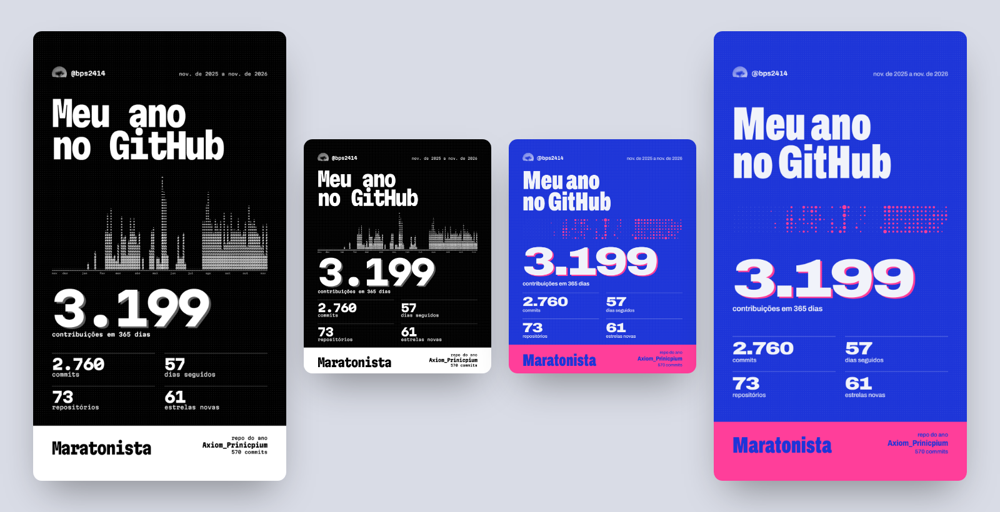
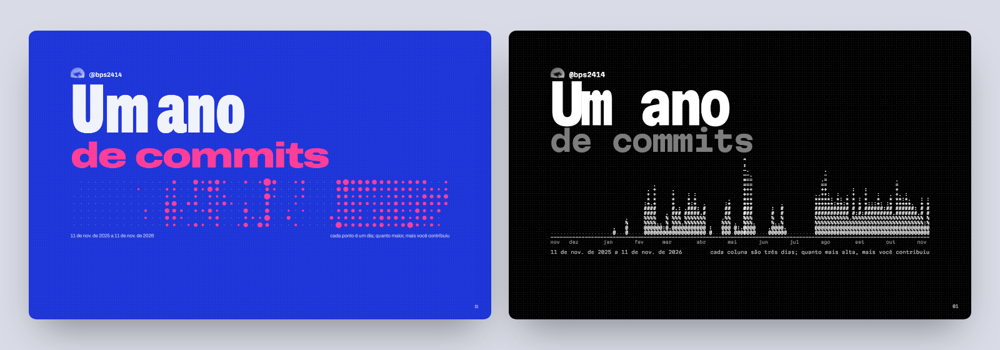

<p align="center">
  
</p>

<h1 align="center">gh-wrapped</h1>

<p align="center"><strong>Your last 365 days on GitHub, private repos included.</strong><br>A recap page you scroll like a zine, and two cards ready for Instagram.</p>

<p align="center">
  <a href="#quick-start"><strong>Quick start</strong></a> ·
  <a href="#how-it-works">How it works</a> ·
  <a href="#faq">FAQ</a> ·
  <a href="README.pt-BR.md">Português</a>
</p>

<p align="center">
  
  
  
  <a href="LICENSE"></a>
</p>



## Why gh-wrapped

- **Your private work counts.** GitHub's contribution API reports private commits as one anonymous number. gh-wrapped reads the commit history of every repository you pushed to, so private repos and repos owned by other people show up by name, with their real counts.
- **Exactly one year.** From today back to the same date last year, not January to December. Run it any day.
- **Nothing to sign up for.** It uses the `gh` login you already have. No server, no token pasted into a website, no dependencies to install.
- **Made to be posted.** Every run exports a 1080×1350 card for the feed and a 1080×1920 card for stories, in two looks.

## Quick start

You need [Node 18+](https://nodejs.org), the [GitHub CLI](https://cli.github.com) signed in (`gh auth login`), and Chrome or Edge for the PNG cards. Windows already ships with Edge.

```bash
npx github:bps2414/gh-wrapped
```

Or clone it and run the script. It has no dependencies:

```bash
git clone https://github.com/bps2414/gh-wrapped
cd gh-wrapped
node wrapped.mjs
```

It takes a minute or two, depending on how many repositories you touched. Everything lands in `./out`:

| File | What it is |
| --- | --- |
| `wrapped-<you>-<date>.html` | The recap in the riso look: blue ink, fluorescent pink, paper |
| `wrapped-<you>-<date>-mono.html` | The same recap in black and white, with the year drawn in ASCII |
| `card-<you>-<date>-feed.png` / `-story.png` | Riso cards for the feed (4:5) and stories (9:16) |
| `card-<you>-<date>-mono-feed.png` / `-mono-story.png` | Mono cards |
| `wrapped-<you>-<date>.json` | Every number behind the page |

Changed the template? `node wrapped.mjs --rebuild` remakes the pages and cards from the last JSON without calling the API again.

## What's in the recap

Thirteen pages, one idea each:

1. The year as a picture: one dot per day in riso, one ASCII column per three days in mono.
2. Total contributions, commits, private commits, pull requests and issues.
3. Your longest streak, highlighted on the year, and your busiest day.
4. The hour you commit most, how much of it happens after 22h, and your latest-night commit message.
5. Your strongest weekday and month.
6. The repositories that took your year, ranked by commits.
7. Languages, weighted by the commits you made in each repository.
8. Lines added and removed.
9. The words you use most in commit messages, and your first commit of the period.
10. Stars your repositories gained, and the repositories you created.
11. Pull requests opened and merged, and the biggest one.
12. Your archetype: night owl, early bird, weekend warrior, marathoner and others, picked from your own numbers.
13. The cards, with download buttons.



## How it works

`wrapped.mjs` talks to GitHub's GraphQL API through `gh api graphql`, so it uses the scopes your `gh` login already has (`repo` is needed for private repositories).

1. **Calendar and totals** come from `contributionsCollection`, the same numbers as the green squares on your profile.
2. **Repositories** are everything in `repositoriesContributedTo` (commits, private and other owners included) plus every repository you own that was pushed in the period.
3. **Commits** are read from each repository's default-branch history, filtered to your account and the 365-day window. Hours, weekdays, lines, words and the per-repo ranking come from these.
4. **Stars** are counted from the star dates on your own repositories.
5. The data is written into `template.html` as JSON, once per look, and a headless Chrome or Edge screenshots the cards.

Times use your computer's time zone.

## FAQ

**Does my token go anywhere?**
No. The script never reads your token: `gh` makes every request to `api.github.com` itself. The pages are local files. The only outside requests they make are for the Google Fonts typefaces and your avatar.

**My commit count is different from my profile.**
Your profile counts contributions, which include pull requests, issues and new repositories, and it hides private commits behind one number. gh-wrapped counts commits on the default branch. Commits that only live on other branches, or that were made with an email not linked to your account, are left out, just as GitHub leaves them out of your graph. The other way around: if you force-pushed, squashed or rebased, the old commits are gone from the repository, but GitHub's graph keeps counting them. gh-wrapped counts the commits that exist today.

**Why are the lines added so different from what I expected?**
Commits that change more than 5,000 lines are skipped in that count. Those are almost always lockfiles, builds or copied dependencies, and one of them can outweigh a year of real work.

**Can I make one for someone else?**
`node wrapped.mjs <login>` works for any user. Without access to their private repositories you get their public work only.

**Why are the pages in Portuguese?**
That's who it was made for first. The template is one file, `template.html`, if you want to translate it.

## License

MIT. See [LICENSE](LICENSE). gh-wrapped is an independent project, not affiliated with or endorsed by GitHub.

---

<p align="center">
  <a href="https://star-history.com/#bps2414/gh-wrapped&Date"></a>
</p>

<p align="center">If your year looked good on a card, a ★ on the repo helps other people find it.</p>
