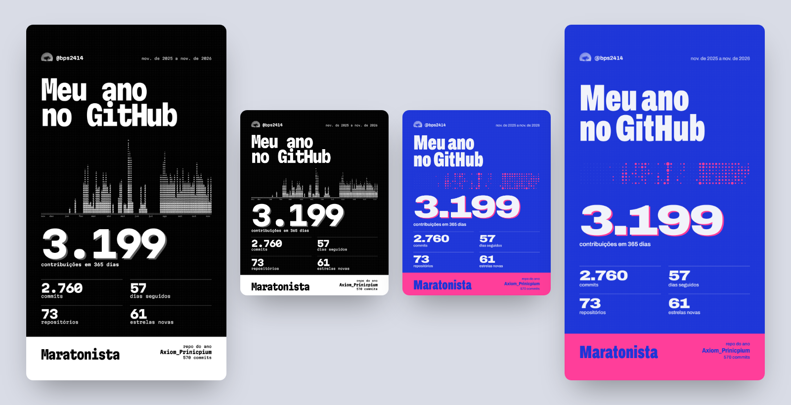
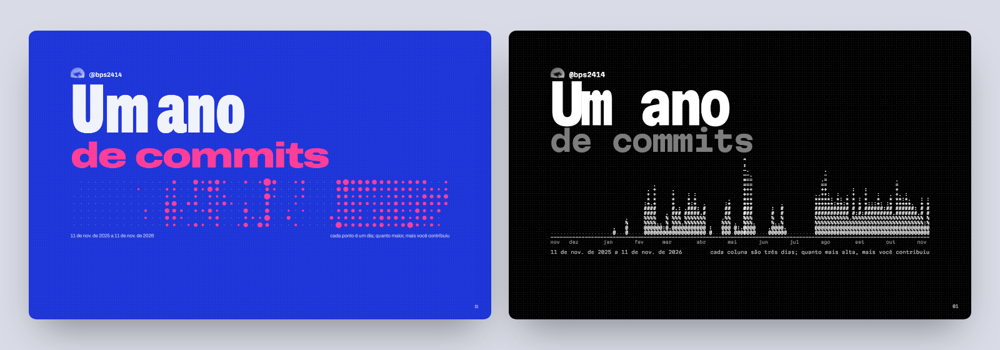

<p align="center">
  
</p>

<h1 align="center">gh-wrapped</h1>

<p align="center"><strong>Seus últimos 365 dias no GitHub, repos privados incluídos.</strong><br>Uma retrospectiva para rolar como um zine e dois cards prontos para o Instagram.</p>

<p align="center">
  <a href="#como-usar"><strong>Como usar</strong></a> ·
  <a href="#como-funciona">Como funciona</a> ·
  <a href="#perguntas-frequentes">Perguntas</a> ·
  <a href="README.md">English</a>
</p>

<p align="center">
  
  
  
  <a href="LICENSE"></a>
</p>



## Por que o gh-wrapped

- **Seu trabalho privado conta.** A API de contribuições do GitHub mostra os commits privados como um número só, sem nome. O gh-wrapped lê o histórico de commits de cada repositório em que você mexeu, então repos privados e repos de outras pessoas aparecem pelo nome, com a contagem real.
- **Exatamente um ano.** De hoje até a mesma data do ano passado, não de janeiro a dezembro. Roda em qualquer dia.
- **Sem cadastro.** Usa o login do `gh` que você já tem. Sem servidor, sem colar token em site, sem dependência para instalar.
- **Feito para postar.** Cada execução exporta um card 1080×1350 para o feed e um 1080×1920 para os stories, nos dois visuais.

## Como usar

Você precisa do [Node 18+](https://nodejs.org), do [GitHub CLI](https://cli.github.com) logado (`gh auth login`) e do Chrome ou Edge para os cards em PNG. O Windows já vem com o Edge.

```bash
npx github:bps2414/gh-wrapped
```

Ou clone e rode o script. Ele não tem dependências:

```bash
git clone https://github.com/bps2414/gh-wrapped
cd gh-wrapped
node wrapped.mjs
```

Leva um ou dois minutos, dependendo de quantos repositórios você mexeu. Tudo sai em `./out`:

| Arquivo | O que é |
| --- | --- |
| `wrapped-<você>-<data>.html` | A retrospectiva no visual riso: tinta azul, rosa flúor, papel |
| `wrapped-<você>-<data>-mono.html` | A mesma retrospectiva em preto e branco, com o ano desenhado em ASCII |
| `card-<você>-<data>-feed.png` / `-story.png` | Cards riso para o feed (4:5) e os stories (9:16) |
| `card-<você>-<data>-mono-feed.png` / `-mono-story.png` | Cards mono |
| `wrapped-<você>-<data>.json` | Todos os números por trás da página |

Mexeu no template? `node wrapped.mjs --rebuild` refaz as páginas e os cards a partir do último JSON, sem chamar a API de novo.

## O que tem na retrospectiva

Treze páginas, uma ideia cada:

1. O ano como imagem: um ponto por dia no riso, uma coluna ASCII a cada três dias no mono.
2. Total de contribuições, commits, commits privados, pull requests e issues.
3. Sua maior sequência, destacada no ano, e seu dia mais cheio.
4. A hora em que você mais commita, quanto disso é depois das 22h e a mensagem do seu commit mais tardio.
5. Seu dia da semana e seu mês mais fortes.
6. Os repositórios que levaram seu ano, por número de commits.
7. Linguagens, pesadas pelos seus commits em cada repositório.
8. Linhas adicionadas e removidas.
9. As palavras que mais aparecem nas suas mensagens de commit e o primeiro commit do período.
10. Estrelas que seus repositórios ganharam e os repositórios que você criou.
11. Pull requests abertos e mergeados, e o maior deles.
12. Seu arquétipo: coruja, madrugador, guerreiro de fim de semana, maratonista e outros, escolhido pelos seus números.
13. Os cards, com botões para baixar.



## Como funciona

O `wrapped.mjs` fala com a API GraphQL do GitHub pelo `gh api graphql`, então usa os escopos que o seu login do `gh` já tem (`repo` é necessário para os repositórios privados).

1. **Calendário e totais** vêm do `contributionsCollection`, os mesmos números dos quadradinhos verdes do seu perfil.
2. **Repositórios** são tudo o que está em `repositoriesContributedTo` (commits, inclusive privados e de outros donos) mais todo repositório seu com push no período.
3. **Commits** são lidos do histórico da branch padrão de cada repositório, filtrados pela sua conta e pela janela de 365 dias. Horários, dias da semana, linhas, palavras e o ranking por repo saem daí.
4. **Estrelas** são contadas pelas datas das estrelas nos seus próprios repositórios.
5. Os dados entram no `template.html` como JSON, uma vez por visual, e um Chrome ou Edge sem janela tira a foto dos cards.

Os horários usam o fuso do seu computador.

## Perguntas frequentes

**Meu token vai para algum lugar?**
Não. O script nunca lê o seu token: é o próprio `gh` que faz cada requisição para `api.github.com`. As páginas são arquivos locais. As únicas requisições externas delas são as fontes do Google Fonts e o seu avatar.

**Minha contagem de commits é diferente da do meu perfil.**
O perfil conta contribuições, que incluem pull requests, issues e repositórios novos, e esconde os commits privados atrás de um número só. O gh-wrapped conta commits na branch padrão. Commits que só existem em outras branches, ou que foram feitos com um email não vinculado à sua conta, ficam de fora, do mesmo jeito que o GitHub deixa de fora do seu gráfico. E o contrário: se você deu force-push, squash ou rebase, os commits antigos somem do repositório, mas o gráfico do GitHub continua contando. O gh-wrapped conta os commits que existem hoje.

**Por que as linhas adicionadas estão tão diferentes do que eu esperava?**
Commits que mudam mais de 5 mil linhas ficam fora dessa conta. Quase sempre são lockfile, build ou dependência copiada, e um só deles pesa mais que um ano de trabalho de verdade.

**Dá para fazer de outra pessoa?**
`node wrapped.mjs <login>` funciona para qualquer usuário. Sem acesso aos repositórios privados dela, sai só o trabalho público.

## Licença

MIT. Veja [LICENSE](LICENSE). O gh-wrapped é um projeto independente, sem vínculo com o GitHub nem aprovação dele.

---

<p align="center">
  <a href="https://star-history.com/#bps2414/gh-wrapped&Date"></a>
</p>

<p align="center">Se o seu ano ficou bonito no card, uma ★ no repo ajuda outras pessoas a acharem.</p>
